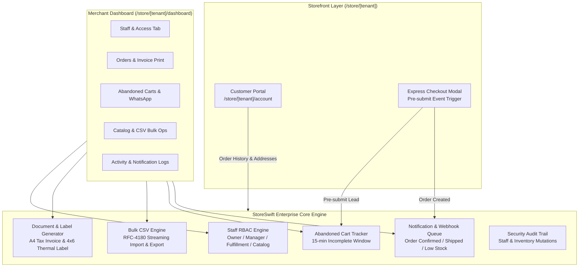

# StoreSwift — Enterprise SaaS Core Pillars Design Specification

**Specification Date:** November 4, 2026  
**Status:** Validated Design Spec  
**Target Systems:** StoreSwift Multi-Tenant SaaS Platform, Merchant Dashboard, Storefront Engine, and Public APIs  

---

## 1. Executive Summary & Objective

StoreSwift currently provides multi-tenant storefronts with 30 curated category templates, an Express Checkout flow with courier zone calculation, a merchant administrative dashboard, and a super-admin operations panel.

To elevate StoreSwift from a single-user store builder to a world-class, enterprise-grade multi-tenant eCommerce SaaS (competing directly with platforms like Shopify, Dukaan, and Shoplazza), this specification defines the architecture, data models, API interfaces, and user experiences for **six foundational SaaS pillars**:

1. **Staff Accounts & Role-Based Access Control (RBAC):** Multi-user store collaboration with granular roles (`owner`, `manager`, `fulfillment`, `catalog_editor`) and plan-gated seat limits (`maxStaff`).
2. **1-Click Printable Invoices & Courier Thermal Packing Slips:** Browser-native `@media print` A4 invoices and 4x6" courier shipping labels with barcode/consignment tracking for warehouse operations.
3. **Bulk CSV Data Engine:** High-performance CSV import for products with downloadable sample templates, plus automated CSV export for orders, accounting, and customer directories.
4. **Storefront Customer Portal & Order History:** End-customer account management at `/store/[tenant]/account` with order tracking, address book, and one-click re-ordering.
5. **Abandoned Cart Recovery Engine:** Real-time pre-submit checkout capture, recovery value analytics, and one-click WhatsApp/SMS recovery dispatch.
6. **Transactional Notification Center & Audit Trail:** Multi-channel notification queue (SMS/WhatsApp/Email triggers) and tamper-evident store audit logging.

---

## 2. Architecture & Data Flow



---

## 3. Detailed Subsystem Specifications

### Pillar 1: Staff Accounts & Role-Based Access Control (RBAC)

#### 1.1 Role Definitions & Permission Matrix
A store is no longer restricted to a single login. Store owners can invite and manage staff members with strictly delineated capability boundaries:

| Permission / Capability | `owner` | `manager` | `fulfillment` | `catalog_editor` |
|---|:---:|:---:|:---:|:---:|
| View Revenue & Analytics | ✅ | ✅ | ❌ | ❌ |
| Manage Products & Stock | ✅ | ✅ | ❌ | ✅ |
| Manage Orders & Shipping | ✅ | ✅ | ✅ | ❌ |
| Print Invoices & Courier Labels | ✅ | ✅ | ✅ | ❌ |
| Manage Coupons & Discounts | ✅ | ✅ | ❌ | ❌ |
| Invite / Remove Staff | ✅ | ❌ | ❌ | ❌ |
| Subscription & Billing Upgrades | ✅ | ❌ | ❌ | ❌ |
| Delete Store or Transfer Ownership | ✅ | ❌ | ❌ | ❌ |

#### 1.2 Plan Limit Enforcement
- **Free Plan:** 1 User (`owner` only). Attempting to add staff triggers `{ upgrade: true, error: "Staff accounts require Medium or Pro plan." }`.
- **Medium Plan (৳499/mo):** Up to 3 staff seats (`PLAN_LIMITS.medium.maxStaff = 3`).
- **Pro Plan (৳999/mo):** Unlimited staff seats (`PLAN_LIMITS.pro.maxStaff = null`).

#### 1.3 Data Model & Interfaces
```typescript
export interface DevStoreStaff {
  id: string;
  storeId: string;
  storeSlug: string;
  email: string;
  name: string;
  phone?: string;
  role: "owner" | "manager" | "fulfillment" | "catalog_editor";
  status: "active" | "invited";
  invitedAt: string;
  lastActiveAt?: string;
}
```

#### 1.4 API Endpoints
- `GET /api/stores/[slug]/staff`: Returns active and invited staff for the store. Requires `owner` or `manager` role.
- `POST /api/stores/[slug]/staff`: Invites or provisions a new staff member. Validates plan seat limits. Requires `owner` role.
- `DELETE /api/stores/[slug]/staff`: Revokes staff access. Prohibits deleting the store owner. Requires `owner` role.

---

### Pillar 2: 1-Click Printable Invoices & Courier Thermal Packing Slips

#### 2.1 A4 Tax / Sales Invoice Specification
- Standard A4 sheet formatting with `@media print` CSS rules (clean margins, zero browser headers/footers, high contrast monochrome/accent).
- **Header:** Store Logo / Wordmark, Merchant Name, Store URL, Customer Care Phone, Date & Order Number.
- **Billing & Shipping Block:** Customer Name, Phone, Delivery Address, Upazila, District, Courier Consignment ID (`ST-XXXXXX`).
- **Itemized Table:** Product Title, Variant, SKU, Unit Price, Quantity, Line Total.
- **Summary Block:** Subtotal, Applied Discount (with coupon code tag), Delivery Fee, and Grand Total formatted in Bangladeshi Taka (৳).
- **Footer:** Merchant return policy terms, barcode representation of order number, and StoreSwift verified checkout badge.

#### 2.2 4x6 Inch (100mm x 150mm) Thermal Courier Packet Label
- Formatted specifically for standard label printers (Zebra, Xprinter, Rongta) used by Bangladeshi couriers (Steadfast, Pathao, RedX).
- **Top Section:** Courier Name ("Steadfast Courier / Pathao Express"), Consignment ID barcode, Date.
- **Middle Section (Large Font):** Recipient Name, District/Zone (e.g. "DHAKA METRO - Inside Dhaka"), Full Delivery Address, Recipient Contact Number (bolded for delivery riders).
- **Bottom Section:** COD Amount to Collect (Large bold boxed: `৳1,450.00 COD`), Order Number reference, and Return Merchant Contact Info.
- **Zero External Dependencies:** Built with pure CSS print media queries and HTML5 SVG barcode generation, avoiding heavy PDF canvas overhead.

---

### Pillar 3: Bulk CSV Data Engine

#### 3.1 Bulk Product Import
- Accepts standard RFC-4180 CSV uploads or raw copy-paste data.
- **Expected Columns:**
  `title, price, comparePrice, stock, category, sku, description, imageUrl`
- **Validation Rules:**
  - `title`: String, min 2 characters.
  - `price`: Positive number, rounded to 2 decimals.
  - `stock`: Non-negative integer.
  - `sku`: Auto-generated if omitted.
- **Feedback UI:** Summarizes valid rows imported, invalid rows flagged with line numbers and exact reasons, and provides a 1-click **"Download Sample CSV"** template.
- Respects store plan product limits (`checkProductLimit`).

#### 3.2 Bulk Data Export Streams
- `GET /api/stores/[slug]/export?type=products`: Downloads all store products in CSV format.
- `GET /api/stores/[slug]/export?type=orders&status=all&from=YYYY-MM-DD&to=YYYY-MM-DD`: Downloads order logs with customer names, items, payments, courier consignment IDs, and financial breakdowns for VAT and accounting.
- `GET /api/stores/[slug]/export?type=customers`: Downloads customer directory (name, phone, district, total orders, total spent) formatted for marketing and Facebook Custom Audience retargeting.

---

### Pillar 4: Storefront Customer Portal & Order History

#### 4.1 Routing & Accessibility
- Accessible at `/store/[tenant]/account`.
- Storefront header displays a "My Account / Orders" link alongside the Shopping Bag and Search icons.

#### 4.2 Frictionless Customer Verification
- End-customers can access their account via:
  1. **Phone / Order Lookup:** Enter mobile number + recent Order Number to instantly authenticate and review past orders.
  2. **Saved Session:** Authenticated customer state persisted in secure local storage or session token.

#### 4.3 Portal Tabs
1. **Order History:** Lists past orders with current lifecycle badges (`pending`, `processing`, `shipped`, `delivered`), itemized thumbnails, and live courier tracking links (`https://storeswift.app/track/[consignmentId]`).
2. **Address Book:** Manage default delivery address, district, and upazila to enable 1-click autofill in `ExpressCheckoutModal`.
3. **One-Click Re-order:** Instantly populate cart with previously purchased items.

---

### Pillar 5: Abandoned Cart Recovery Engine

#### 5.1 Pre-Submit Lead Capture
- In [`src/components/store/express-checkout-modal.tsx`](file:///e:/Project/Ecomerce%20solution/src/components/store/express-checkout-modal.tsx), when a customer enters their Name and Mobile Phone, a debounced background lead ping (`POST /api/stores/[slug]/abandoned-carts`) records the cart session.
- If the order completes normally within 15 minutes, the record is automatically flagged as `converted`.
- If no completed order occurs after 15 minutes, the cart is marked `abandoned`.

#### 5.2 Merchant Recovery Tools
- Merchant Dashboard displays an **Abandoned Carts** tab showing:
  - Customer Name, Phone, District, Abandoned Items, and Total Value.
  - Time elapsed since abandonment.
  - **One-Click WhatsApp Recovery Button:** Generates a direct WhatsApp link:
    ```
    https://wa.me/88017XXXXXXXX?text=Hello%20[Name],%20you%20left%20[Items]%20in%20your%20bag%20at%20[StoreName].%20Complete%20your%20order%20now%20with%20free%20delivery:%20[RecoveryURL]
    ```

---

### Pillar 6: Transactional Notification Center & Audit Trail

#### 6.1 Transactional Notification Queue
- Records all automated customer messaging triggers:
  - **Order Confirmed Trigger:** Order number, total amount, delivery address.
  - **Courier Dispatched Trigger:** Courier name (Steadfast), Tracking Consignment ID, live tracking URL.
  - **Low-Stock Merchant Alert:** Fired when product stock drops below 5 units.
- Displays payload logs in the Merchant Dashboard with simulation preview (renders SMS bubble & email preview).

#### 6.2 Security Audit Trail
- Logs high-impact merchant operations for operational accountability:
  - Staff invitations and role modifications.
  - Manual price or stock adjustments.
  - Order status changes and cancellations.
  - Plan upgrades and payment verification.

---

## 4. Implementation Phasing

1. **Phase 1: Backend Data Models & Core APIs**
   - Extend `devStore` and database schemas with staff members, abandoned carts, audit events, and export endpoints.
   - Implement `/api/stores/[slug]/staff`, `/api/stores/[slug]/export`, `/api/stores/[slug]/import`, `/api/stores/[slug]/abandoned-carts`.
2. **Phase 2: Document Printing & Courier Packing Slips**
   - Build printable A4 Tax Invoice and 4x6" Thermal Shipping Label component with CSS print media queries.
   - Wire "Print Invoice" and "Print Shipping Label" buttons into merchant order rows.
3. **Phase 3: Bulk CSV Import & Export UI**
   - Create CSV upload modal with drag-and-drop, sample template download, and progress feedback.
   - Add export buttons to Orders and Products dashboard tabs.
4. **Phase 4: Abandoned Cart & Notification Center**
   - Add pre-submit capture in checkout modal.
   - Build Abandoned Carts dashboard view with 1-click WhatsApp recovery links.
   - Implement notification trigger viewer and activity audit log.
5. **Phase 5: Storefront Customer Portal**
   - Build `/store/[tenant]/account` customer portal page with order tracking, address book, and one-click re-order.
6. **Phase 6: Integration Testing & Verification**
   - Add end-to-end integration test suite covering all 6 pillars.
   - Run typecheck, Vitest, and production build.

---

## 5. Security & Isolation Constraints

- **Multi-Tenant Isolation:** All operations are strictly scoped to the store slug/store ID. Staff of Store A can never access Store B.
- **RBAC Strictness:** Fulfillment and catalog editors cannot access store revenue or profit KPIs.
- **XSS & CSV Injection Shield:** All imported CSV cells are sanitized against formula injection (`=`, `@`, `+`, `-` prefixes escaped).
- **Server-Authoritative Precision:** Prices imported or calculated are sanitized to non-negative floats rounded to 2 decimal places.
